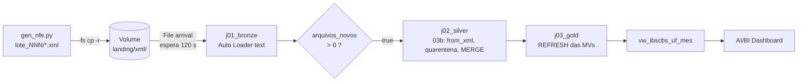

# Fluxo de ponta a ponta: carga, observabilidade e qualidade

Todo pipeline deste projeto é pensado em **três linhas paralelas**, planejadas juntas, etapa por etapa:

| Linha | Pergunta | Quando falha, o problema é... |
|---|---|---|
| **Carga** | o que entra, o que sai, onde grava? | — |
| **Observabilidade** | a carga rodou, chegou ao fim e não perdeu nada? | do **processo**: reprocessar, investigar a run |
| **Qualidade** | o conteúdo que entrou é válido e coerente? qual a verdade de referência? | da **origem**: quarentena ou aviso ao negócio |

Antes das três linhas vem o **objetivo**: ele define o que medir (ex.: "painel de IBS/CBS atualizado após cada
lote" → frescor é métrica de observabilidade; chave inválida é erro intolerável de qualidade).

## 1. Linha de carga (só o que carrega notas)

O ramo gêmeo `nfe_ldp` (Lakeflow Declarative Pipeline) roda em paralelo para estudo e reconciliação;
o painel lê `nfe_gold`. O Job completo, com os controles, está em [job_nfe.md](job_nfe.md).

## 2. As três linhas por camada

Legenda de onde cada controle roda: **[Job]** a cada execução · **[pipeline]** só no ramo `nfe_ldp` ·
**[manual]** notebook rodado à mão · **[marco 7]** planejado.

| | Landing | Bronze | Silver | Gold | Dashboard |
|---|---|---|---|---|---|
| **Carga** | `gen_nfe.py` → Volume `landing/xml/` · gatilho *file arrival* | `j01_bronze`: Auto Loader text + wholeText → `nfe_xml_raw` (XML bruto, 1 linha por arquivo) · condição `arquivos_novos > 0` | `j02_silver` (`%run` 03b): `from_xml` → `nfe_doc` \| `nfe_quarentena` → MERGE nota, item, pagamento, duplicata | `j03_gold`: REFRESH `ft_nfe_item` → `ft_nfe_documento` → `ag_nfe_ibscbs_mensal` | `vw_ibscbs_uf_mes` → AI/BI Dashboard **[marco 7]** |
| **Observabilidade** *rodou e entregou tudo?* | Chegou tudo? inventário do Volume (`binaryFile`) **[Job]** · status, duração, retries da run **[Job]** | Ingeriu tudo? `arquivos_novos` (task value) **[Job]** · completude: `faltando_na_bronze` **[Job]** | Processou tudo? bronze = quarentena + docs_validos, senão `INCOMPLETO` **[Job]** · reenvios, notas vigentes **[Job]** | Bate? `j04_reconcilia` notebook × pipeline com corte comum (D017) **[Job]** · modo de refresh da MV **[manual]** | Saudável agora? `ctrl_lote` (ALL_DONE) **[Job]** · frescor, latência, duração, alerta **[marco 7]** |
| **Qualidade** *o dado está correto?* | Verdade conhecida: manifesto do gerador → `landing/manifesto/` | Nenhuma regra barra: o bruto é a evidência (D007) | **Erro → quarentena** (5 motivos) **[Job]** · constraints Delta **[Job]** · **Aviso** `vw_dq_alertas` **[manual]** · gabarito 31/31 **[manual]** · expectations **[pipeline]** | Integridade: chaves órfãs, silver × gold (04c) **[manual]** · expectations da fato **[pipeline]** | Tendência: `ctrl_dq` por run **[marco 7]** |

## 3. Onde as linhas se tocam

A **quarentena** serve às duas perguntas. A observabilidade usa a **contagem** (bronze = quarentena +
docs_validos prova que nada sumiu); a qualidade usa o **motivo**. Um lote com notas barradas pode ter status
`OK`: o pipeline fez exatamente o que devia.

## 4. O que o mapa revelou (insumo do marco 7)

1. **Qualidade fora do Job**: alertas, gabarito e órfãos só rodam à mão → task `dq` gravando `ctrl_dq`
2. **Sem frescor nem latência**: calculáveis com `modificado_em`, `carregado_em`, `executado_em`
3. **Job verde ≠ carga saudável**: o status da run vem das tasks folha; com a `ctrl_lote` (ALL_DONE) como
   folha, uma reconciliação falha aparece como *Succeeded* (`SuccessWithFailures`). Quem avisa é a
   `ctrl_lote`, não a lista de runs → SQL Alert sobre o status

Plano do painel: [dashboard.md](dashboard.md).
